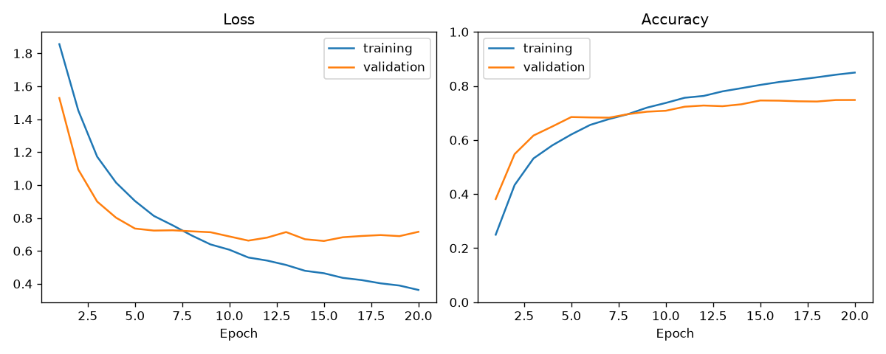
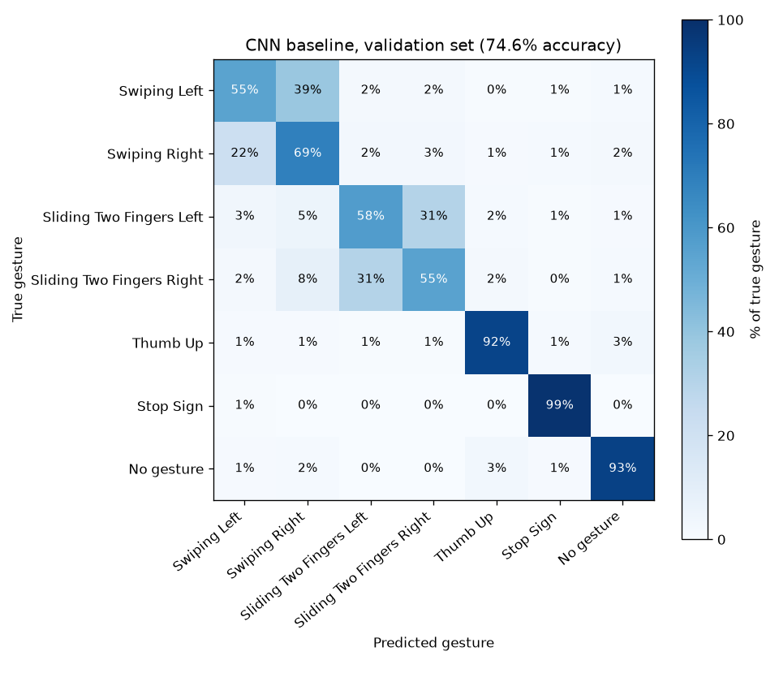

# CNN Baseline

**Final model:** EXP-004, a pretrained MobileNetV2 frame encoder with frame averaging.
**Result:** 74.6% accuracy on the validation set (5,946 videos). Random guessing is 14.3%.
**Main weakness:** it mixes up left and right and 67% of its mistakes are direction errors, which is the gap the CNN-GRU can help with.

## How the model works

1. The same CNN looks at each of the 16 frames on its own and turns each one into a list of numbers describing what it sees.
2. The 16 frame descriptions are averaged into one.
3. A small dense layer makes one prediction for the whole clip: 7 probabilities, one per gesture.

The model ignores the order of the frames on purpose. That is what makes it a fair baseline for the CNN-GRU, which uses the same frame encoder but reads the frames in order.

```
clip (16, 112, 112, 3)
  -> MobileNetV2 on each frame (pretrained on ImageNet)  -> (16, 1280)
  -> average across the 16 frames                        -> (1280)
  -> Dense 128 + ReLU, Dropout 0.3
  -> Dense 7 + softmax                                   -> 7 probabilities
```

| | |
|---|---|
| Input | 16 frames, 112x112 RGB, values 0 to 1 |
| Output | 7 probabilities (see `config/gesture_classes.json`) |
| Parameters | 575,079 total, 560,999 trainable |
| Saved model | `checkpoints/cnn_baseline_EXP-004.keras` (not in Git, shared directly) |

## Final settings (EXP-004)

| Setting | Value |
|---|---|
| Frame encoder | MobileNetV2, width 0.35, pretrained on ImageNet |
| Frame combining | Average frame features, then predict once |
| Learning rate | 0.0001 (Adam) |
| Batch size | 8 clips |
| Epochs | Up to 20, early stopping with patience 6 on validation loss |
| Training data | First 8,000 videos of `train.csv` (already shuffled) |
| Validation data | All 5,946 videos of `validation.csv` |
| Augmentation | Brightness 0.8 to 1.2 and rotation of up to ±5 degrees, same for all frames of a video, training only |
| Hardware | Laptop CPU, no GPU |
| Versions | TensorFlow 2.21.0, Keras 3.15.1, Python 3.12 |

## Experiments

All runs used 8,000 training videos and the full validation set unless noted. Accuracy is taken from the epoch with the lowest validation loss.

| Run | What changed | Val accuracy | Val loss | Notes |
|---|---|---|---|---|
| EXP-000-smoke | Pipeline check, 500 training and 200 validation videos, 2 epochs | 14.5% | 1.981 | Confirmed training works on real data |
| EXP-001 | Small CNN from scratch, each frame predicts, then average | 14.5% | 1.946 | Stuck at chance. Stopped after 5 epochs |
| EXP-002 | Small CNN from scratch, average frame features, then predict | 15.0% | 1.946 | Still stuck at chance. Stopped after 3 epochs |
| EXP-000-overfit | Same as EXP-001 on only 64 training and 64 validation videos, 30 epochs | 18.8% | 2.002 | Training accuracy reached 78 to 83%, so the model could memorize and the data and code were fine |
| EXP-003 | Pretrained MobileNetV2, brightness only | 70.6% (epoch 9) | 0.691 | Overfitting after epoch 9. 199 minutes |
| **EXP-004** | **Same as EXP-003, plus rotation** | **74.6% (epoch 15)** | **0.660** | **Final baseline.** 251 minutes |

A loss of 1.946 is what a model gets when it gives every gesture the same 1/7 chance, so EXP-001 and EXP-002 learned nothing.

### What we learned

1. **The small CNN could not learn from scratch.** It memorized 64 videos but could not find general patterns in 8,000. Changing how frames are combined (EXP-001 vs EXP-002) did not fix it.
2. **A pretrained encoder fixed it right away.** MobileNetV2 already recognizes edges and shapes from millions of photos. Validation accuracy went from 14% to 41% after one epoch.
3. **Rotation helped.** Adding rotation raised validation accuracy by 4 points and pushed the start of overfitting from epoch 9 to epoch 15.



## Weaknesses

Measured on the validation set with `analyze_cnn.py`. The test set was not used.



| Gesture | Accuracy | Most confused with |
|---|---|---|
| Stop Sign | 98.6% | Swiping Left (1%) |
| No gesture | 93.2% | Thumb Up (3%) |
| Thumb Up | 92.0% | No gesture (3%) |
| Swiping Right | 68.9% | Swiping Left (22%) |
| Sliding Two Fingers Left | 57.7% | Sliding Two Fingers Right (31%) |
| Sliding Two Fingers Right | 55.2% | Sliding Two Fingers Left (31%) |
| Swiping Left | 54.9% | Swiping Right (39%) |

1. **Left vs right.** Of 1,509 mistakes, 1,018 (67%) are the right hand shape with the wrong direction. Only 139 (9%) are the wrong hand shape (swipe vs two fingers). The proposal expected hand shape to be the main confusion, but direction is the bigger problem. This is expected for a model that ignores frame order, and it is what the CNN-GRU should fix.
2. **The swipes are still above a coin flip.** The four swipe gestures average 59%, not 50%, so the model picks up some direction from still frames, likely from hand position or motion blur.
3. **It leans toward Swiping Right.** 39% of Swiping Left videos are called Right, but only 22% of Swiping Right videos are called Left. In the app this would mean more accidental "next slide" commands than "previous slide".
4. **Some false triggers.** 7% of No gesture videos are predicted as an action, most often Thumb Up (3%), which maps to "start presentation". The confidence threshold in the webcam app should catch some of these.
5. **Overfitting.** After epoch 15, training accuracy kept rising (80% to 85%) while validation loss went up. Early stopping kept the epoch 15 model.

## Limits of this baseline

- **Trained on 8,000 of the 23,786 training videos** to keep CPU training to about 4 hours. More data may improve results.
- **Uses a pretrained encoder.** The proposal did not specify one. The from-scratch CNN did not learn (EXP-001, EXP-002).
- **Augmentation is random each epoch** with no fixed seed, so a rerun will give slightly different numbers.
- **No GPU.** One epoch takes about 13 minutes on a laptop CPU.

## Changes from the proposal

- **Frame combining:** the proposal planned to average frame-level predictions. That version (EXP-001) stayed at chance, so the final model averages frame features instead. It still makes one prediction per clip and still ignores frame order, so the comparison with the CNN-GRU is fair.
- **Pretrained encoder:** MobileNetV2 pretrained on ImageNet, as explained above.

## How to reproduce

From the project root, with the frames set up as in `docs/dataset.md`:

```
python src/gesture_recognition/training/train_cnn.py
python src/gesture_recognition/training/analyze_cnn.py --model checkpoints/cnn_baseline_EXP-004.keras --output experiments/cnn_baseline/EXP-004/weaknesses
python -m pytest tests/test_models.py tests/test_analysis.py
```

All settings come from `configs/cnn.yaml`. Each run writes its results to `experiments/cnn_baseline/<experiment_id>/`.

## For other members

| Function | File | Use |
|---|---|---|
| `build_pretrained_frame_encoder()` | `models/cnn.py` | The frame encoder, so the CNN-GRU sees frames the same way |
| `build_cnn_baseline()`, `compile_model()` | `models/cnn.py` | Rebuild or tune the baseline |
| `make_real_datasets()`, `save_curves()` | `training/train_cnn.py` | Same data loading and graphs for both models |
| `analyze_cnn()` | `training/analyze_cnn.py` | Per-gesture accuracy and confusion matrix for any saved model |

For a fair comparison, the CNN-GRU should use the same encoder, learning rate, batch size, training videos and augmentation.